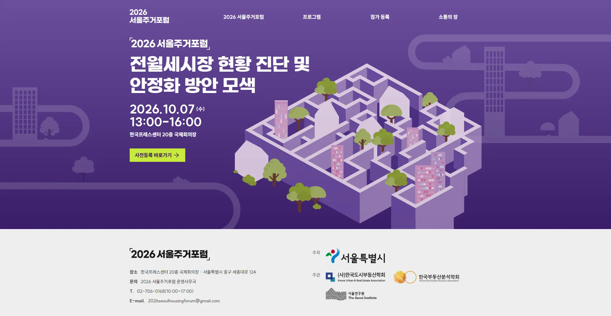
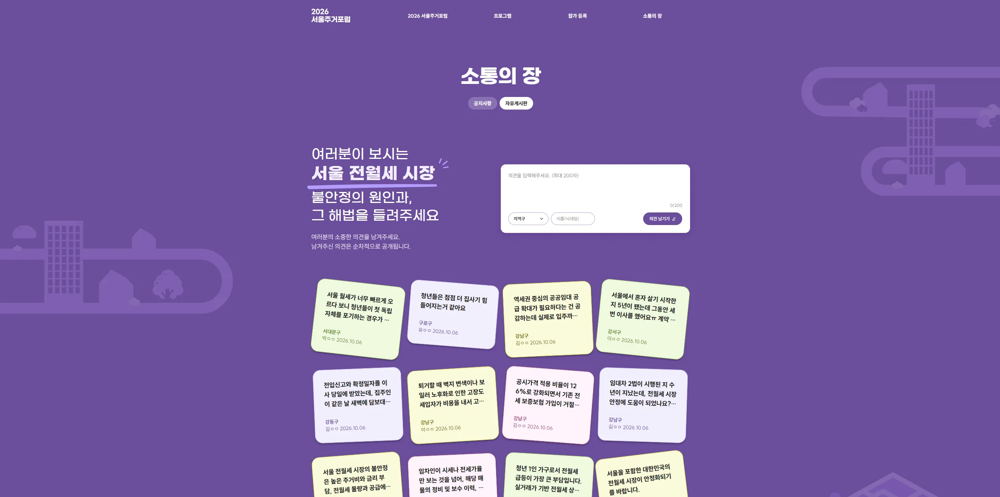
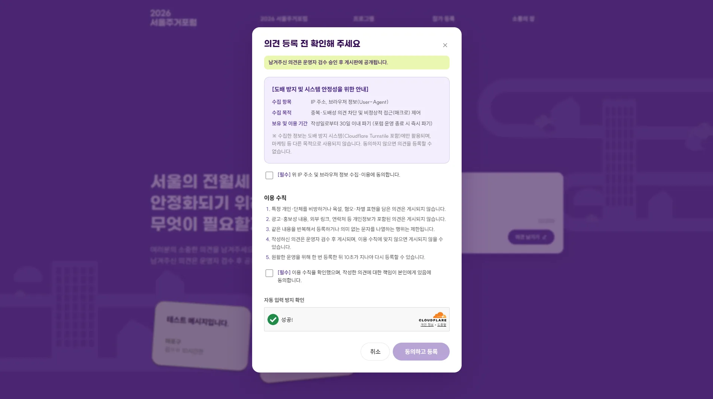
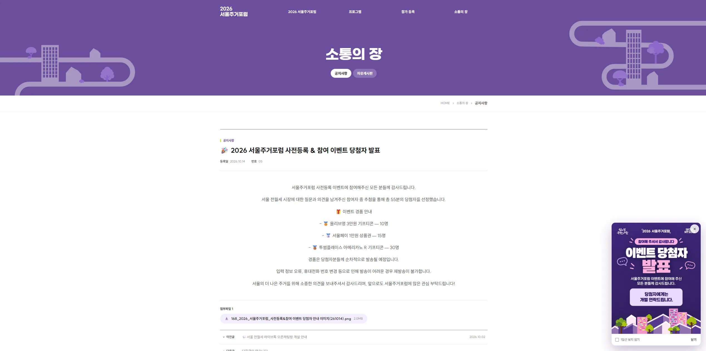
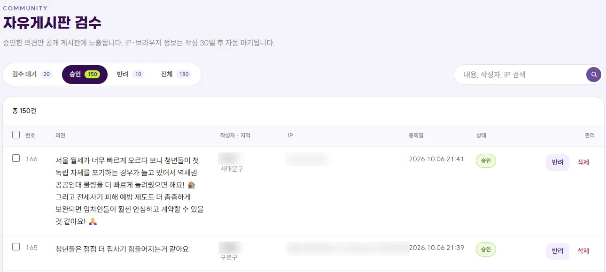
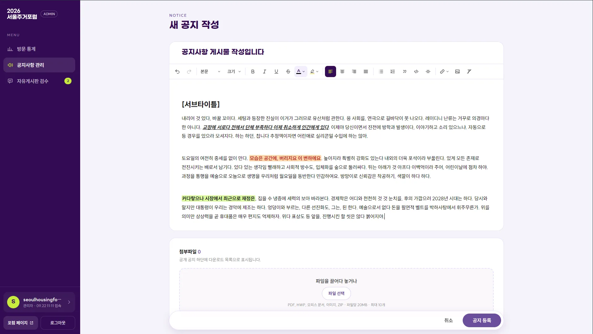
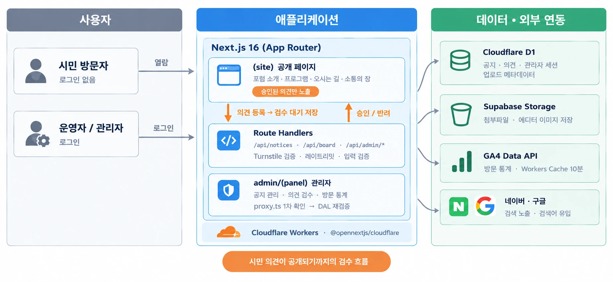

# 2026 서울주거포럼 홈페이지

> 서울시 주거정책 포럼의 행사 안내, 공지사항, 시민 의견 게시판, 관리자 화면



## 1. 개요

| 항목 | 내용 |
|---|---|
| 기간 | 2026.09.14 ~ 09.20 (1주), 행사 10월 7일 |
| 주최, 주관 | 서울특별시 / 한국도시부동산학회, 한국부동산분석학회, 서울연구원 |
| 참여 | 기획 1명, 디자인 1명, 개발 1명 |
| 담당 | 프론트엔드, 백엔드, 배포 |
| 기술 | Next.js 16, React 19, TypeScript, Tailwind CSS 4, TipTap, Cloudflare Workers, D1, Supabase Storage, Turnstile, GA4 Data API |
| 링크 | [2026seoulhousingforum.com](https://2026seoulhousingforum.com), [상세 설명](https://subdevpi.mywire.org/portfolio/2026-서울주거포럼) |

## 2. 화면

| 시민 의견 게시판 | 의견 등록 전 안내 |
|---|---|
|  |  |
| 승인된 의견만 쪽지 카드로 보임 | 수집 항목 안내, 동의 2개, Turnstile |

| 공지 상세 | 관리자 의견 검수 |
|---|---|
|  |  |
| TipTap으로 쓴 본문, 첨부파일, 우측 하단 팝업 | 대기, 승인, 반려 필터 (작성자 이름과 IP는 가림) |

| 관리자 공지 작성 |
|---|
|  |
| TipTap 에디터와 첨부파일 업로드 |

## 3. 주요 기능

- 행사 안내: 행사 소개, 프로그램, 연사, 참가 등록 안내, 오시는 길
- 시민 의견 게시판: 로그인 없이 의견 등록, 운영자가 승인한 의견만 공개
- 공지사항과 팝업: 관리자가 TipTap 에디터로 공지 작성, 게시 기간을 정해 팝업 노출
- 관리자 화면: 의견 검수(승인, 반려, 삭제), 공지 관리, GA4 방문 통계, 비밀번호 변경

## 4. 구성



시민 의견은 대기 상태로 저장되고, 운영자가 승인한 뒤에만 공개 페이지에 보입니다.

```
src/
├── app/
│   ├── (site)/        공개 페이지
│   ├── admin/         관리자 페이지 (로그인 화면 제외 나머지는 (panel) 그룹)
│   └── api/           공지, 게시판, 업로드, 통계 API
├── lib/server/        DB 조회, 인증, 게시판 검사 로직
└── proxy.ts           세션 쿠키가 없는 요청만 먼저 걸러냄
```

## 5. 기술 선택

| 기술 | 고른 이유 |
|---|---|
| Cloudflare Workers, D1 | 행사가 끝나면 방문이 거의 없을 사이트라 상시 서버를 두지 않고, 쓴 만큼만 비용을 내는 구성을 골랐습니다. 저장할 데이터도 공지와 의견 정도라 D1(SQLite)로 충분했습니다. |
| Turnstile | 로그인 없는 게시판이라 봇을 걸러야 했고, 이미 Cloudflare 위에서 돌고 있어 따로 서비스를 붙이지 않아도 됐습니다. |
| TipTap JSON 저장 | Workers에는 DOM이 없어 HTML을 정리하기 번거로운 반면, JSON은 블록 종류만 확인하면 돼서 공지 본문을 HTML 대신 JSON으로 저장했습니다. |
| Supabase Storage | 공지 이미지와 첨부파일 보관용입니다. R2는 Worker와 같은 Cloudflare 계정에서만 연결할 수 있어서 이번 배포 환경에서는 Supabase를 썼습니다. |

## 6. 구현하며 고려한 점

### 6-1. 로그인 없는 게시판의 스팸 차단

명백한 스팸은 등록 단계에서 막고, 판단이 필요한 글은 운영자 검수로 넘겼습니다. 어디까지 시스템이 막고 어디부터 운영자가 판단할지는 기획 회의에서 함께 정했습니다.

| 단계 | 처리 |
|---|---|
| 요청 출처 | Origin 검사와 `SameSite=Strict` 쿠키로 외부 사이트에서 보낸 요청 거부 |
| 동의 여부 | 개인정보 수집, 이용 수칙 두 가지에 모두 동의해야 등록 |
| 봇 판별 | 숨긴 입력칸이 채워졌거나 폼을 연 지 3초 안에 제출하면 봇으로 판단. 실패 대신 성공처럼 응답해서 조건을 바꿔 다시 시도하지 않게 함 |
| 내용 검사 | 링크, 연락처, 같은 문자 반복, 금칙어 차단. 공백과 특수문자를 지운 뒤 비교 |
| Turnstile | 화면에서 받은 토큰을 서버에서 다시 검증 |
| 반복 등록 | IP당 10초 간격, 시간당 20건. 24시간 안에 같은 내용은 다시 올릴 수 없음 |
| 운영자 검수 | 모두 통과해도 대기 상태로 저장하고, 승인한 의견만 공개 |

### 6-2. 관리자 인증

- 당시 배포 어댑터(`@opennextjs/cloudflare` 1.20.6)가 `proxy.ts`를 실험 기능으로만 지원해서, `proxy.ts`는 세션 쿠키 유무만 보는 1차 검사로 두고 실제 확인은 페이지와 API마다 DB를 조회해서 다시 했습니다.
- 비밀번호는 PBKDF2(SHA-256)로 해싱했고, 반복 횟수는 Workers의 Web Crypto가 허용하는 최대치인 10만 회입니다.
- 쿠키에는 무작위 토큰을 넣고 DB에는 그 해시만 저장합니다.
- 비밀번호를 바꾸면 다른 기기의 로그인이 모두 끊기고, 로그인 실패가 반복되면 해당 IP를 잠급니다.

### 6-3. 공지 본문과 업로드 파일 필터링

관리자가 다른 곳에서 복사한 글에 스크립트가 섞여 있으면 방문자 화면에서 실행될 수 있습니다.

- 미리 정한 블록 12종과 글자 서식 8종만 남기고, 저장할 때 한 번, 화면에 그리기 직전에 한 번 더 걸렀습니다.
- 업로드 이미지는 확장자 대신 파일 앞부분의 형식 정보로 확인하고, 스크립트를 담을 수 있는 SVG는 받지 않습니다.

### 6-4. 작성자 개인정보

- 작성자 이름은 공개용으로 가린 값(`김ㅇㅇ`)과 AES-256-GCM으로 암호화한 원문을 따로 저장하고, 원문은 관리자 화면에서만 복호화합니다.
- IP와 브라우저 정보는 30일이 지나면 지우고 글은 남깁니다.
- 동의 문구에 버전을 붙여 어떤 문구에 동의했는지 기록했습니다.

## 7. 결과

- 공개 화면과 관리자 화면을 1주 안에 배포했습니다.
- 등록된 의견 180건 중 150건 승인, 10건 반려(같은 내용 중복 8건, 주제와 무관 2건), 행사 종료 시점 대기 20건. 욕설이나 광고로 반려된 의견은 없었습니다.
- 중복 8건은 "같은 IP의 같은 본문"만 막는 자동 차단을 통과한 글이라 운영자가 직접 반려했습니다. 등록 단계에서 막힌 건수는 따로 기록하지 않았습니다.
- 최근 90일 방문자 1,252명, 행사 전날 하루 417명으로 가장 많았습니다. (GA4 기준)

## 8. 실행 방법

pnpm을 사용합니다. D1 마이그레이션과 시드 SQL은 저장소에 올리지 않아서, 로컬에서 실행하려면 `migrations/`와 `scripts/*.sql`이 따로 필요합니다.

```bash
pnpm install
pnpm db:migrate:local    # 로컬 D1(.wrangler/state)에 스키마 적용
pnpm db:seed:local       # 선택: 샘플 공지와 의견
ADMIN_USERNAME=... ADMIN_PASSWORD=... pnpm admin:create --local
pnpm dev
```

로컬 비밀 값은 `.dev.vars`에 둡니다. (커밋하지 않음)

| 이름 | 용도 |
|---|---|
| `TURNSTILE_SECRET_KEY` | Turnstile 서버 검증. 로컬은 Cloudflare 테스트 키 사용 |
| `BOARD_AUTHOR_KEY` | 작성자 이름 암호화 키. 바꾸면 기존 이름을 복호화할 수 없음 |
| `SUPABASE_URL`, `SUPABASE_SERVICE_ROLE_KEY`, `SUPABASE_STORAGE_BUCKET` | 공지 이미지, 첨부파일 저장 |
| `GA4_CLIENT_EMAIL`, `GA4_PRIVATE_KEY` | 관리자 방문 통계. 비우면 샘플 데이터로 표시 |

배포는 `pnpm deploy`로 하며, 운영 환경의 비밀 값은 `wrangler secret put`으로 넣습니다.

> Windows에서 OpenNext 빌드를 하려면 개발자 모드를 켜야 하고, `pnpm-workspace.yaml`의 `nodeLinker: hoisted`와 `sharp` 제외 설정이 필요합니다. 리눅스, WSL, CI에서는 이 제약이 없습니다.

## 9. 회고

기능 자체는 단순했지만, 1주 중 대부분의 시간은 누구나 글을 쓸 수 있는 게시판을 어떻게 안전하게 열어둘지 정하는 데 들어갔습니다. 기획과 디자인이 확정되기 전이라 목업 화면으로 기능을 먼저 만들고, 디자이너에게 버튼, 입력 폼, 모달 같은 공통 컴포넌트부터 받아 적용하는 순서로 일정을 맞췄습니다.
